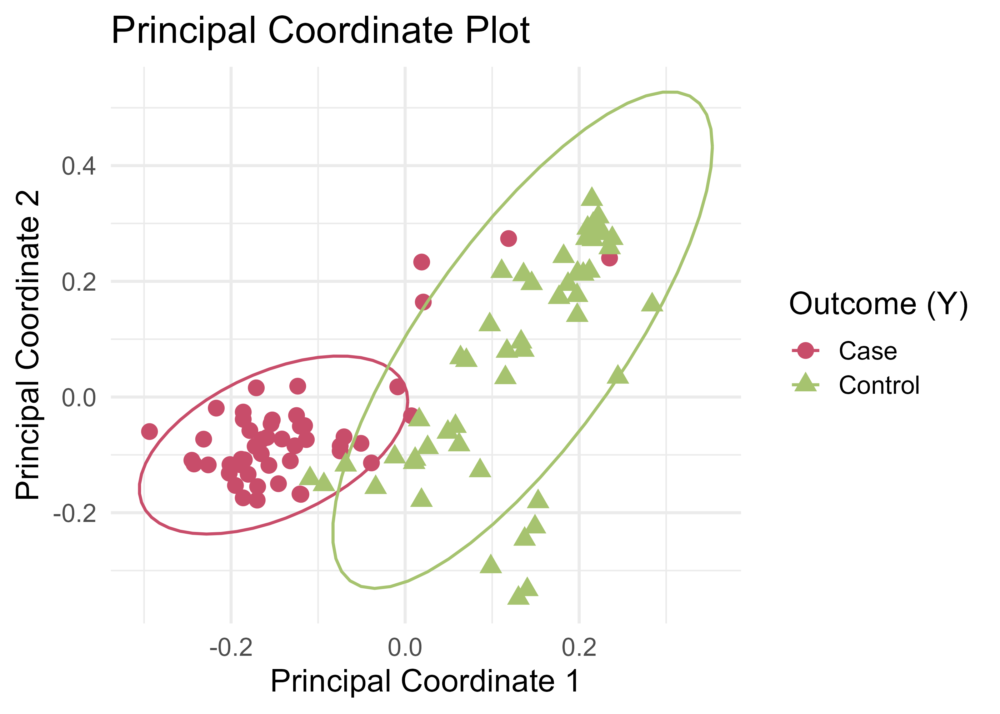
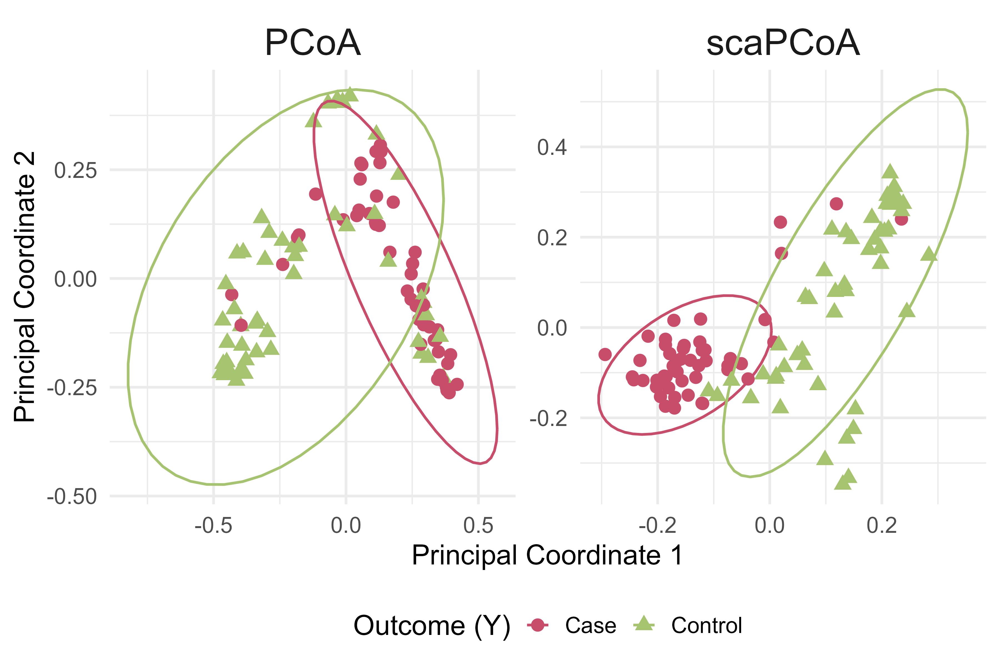

# scaPCoA: Supervised and Covariate-Adjusted Principal Coordinate Analysis

Given that the gut microbiome has been shown to play a critical role in human health, discerning the relationship between microbial taxa and disease outcomes or phenotypes is of interest. Often, this involves association testing, predictive modeling, and visualizing trends in the data. Principal coordinates analysis (**PCoA**) is a commonly used dimension reduction technique in microbiome studies. PCoA relies on pairwise distances between samples and serves as a nonlinear alternative to the classic principal component analysis when non-Euclidean distances are used. Its low-dimensional embeddings provide intuitive visualizations but do not incorporate outcome-related information. Therefore, the low-dimensional principal coordinates may have poor performance in visualizing outcome differences, as well as in downstream disease prediction tasks. Additionally, covariates, such as demographics, lifestyle factors, and technical artifacts, can obscure true biological signals, leading to masked or spurious associations and limited generalizability. To address these limitations, we propose a supervised and covariate-adjusted PCoA algorithm (**scaPCoA**). By utilizing outcome information, while simultaneously minimizing the influence of nuisance variables, our method produces low-dimensional embeddings that better separate disease outcomes in visualizations and result in improved accuracy in downstream regression and classification tasks. We demonstrate the effectiveness of the proposed method and highlight its ability to extract important associations between the microbiome and disease outcomes while mitigating nuisance variation through simulations and application to real microbiome profiling studies.

## Installation

You can install the development version of **scaPCoA** from GitHub using either `remotes` or `pak`.

**Option 1: Using `remotes`**

```r
remotes::install_github("rdeek-lab/scaPCoA")
```

**Option 2: Using `pak`**

If `pak` is not installed, follow its [installation instructions](https://pak.r-lib.org/#installation). If you prefer to not update dependencies use `upgrade = FALSE`.

```r
pak::pkg_install("rdeek-lab/scaPCoA", upgrade = TRUE)
```

After installation, load the package:

```r
library(scaPCoA)
```

## Usage
`scapcoa()` is the main function for running scaPCoA and scaPCoA-R.

1.  **Visualization**: The coordinates estimated by `scapcoa` can be plotted to visualize outcome-associated patterns.

2.  **Prediction**: The coordinates estimated by `scapcoa` can be used as predictive features in downstream regression or classification models for
    continuous or binary outcomes. 


### Input format and example data

`scapcoa()` accepts a list containing:

- `X`: a numeric microbial abundance matrix, with samples in rows and features in columns.
- `Y`: a continuous or binary outcome.
- `Z`: a numeric covariate matrix, with samples in rows. Encode categorical covariates using dummy variables (e.g., one indicator per non-reference category).

The simulated dataset `data_microbe` follows this format and additionally includes `features_signals`, which identifies the outcome-associated microbial features. This additional information is provided for reference and is not required by `scapcoa()`.

```{r}
data(data_microbe)
```

## Example
Set `residualization = FALSE` to run scaPCoA or `residualization = TRUE` to run scaPCoA-R. The residualization step in scaPCoA-R is designed to help separate outcome-associated variation from covariate-associated variation. The example below runs scaPCoA using Bray–Curtis dissimilarities.

``` r
results <- scapcoa(obj = data_microbe, 
                   method = "bray", 
                   lambda_ls = c(0, 0.001, 0.005, 0.01, 0.02, 0.05,
                                 0.1, 0.2, 0.5, 1, 2), 
                   nPC = 3, residualization = FALSE)

# Estimated principal coordinates
pc <- results$PC.scores

# Eigenvalues
eigen_values <- results$eigen_values
```

## Results
The first two principal coordinates are plotted below, with samples colored and shaped by outcome (case or control). This visualization illustrates the outcome-associated patterns captured by scaPCoA in the simulated microbiome data.
``` r
pc %>%
  as.data.frame() %>%
  mutate(Y = ifelse(data_microbe$Y == 1, "Case", "Control")) %>%
  ggplot(aes(x = V1, y = V2, color = Y, shape = Y)) +
  geom_point(size = 3.5, alpha = 1) +
  stat_ellipse(aes(group = Y), linetype = 1) +
  labs(
    x = "Principal Coordinate 1",
    y = "Principal Coordinate 2",
    shape = "Outcome (Y)",
    color = "Outcome (Y)",
    title = "Principal Coordinate Plot"
  ) +
  theme_minimal(base_size = 16) +
  scale_color_manual(values = c("Case" = "#C84D6A", "Control" = "#A6C36F"))
```



Additionally, the columns of `pc` contain the estimated principal coordinates. The first few columns (e.g., `pc[, 1:3]`) can be used as predictive features in a regression or classification model for the outcome.

## Comparison of PCoA and scaPCoA

PCoA summarizes variation in microbial composition without using outcome or covariate information. In contrast, scaPCoA incorporates outcome supervision and covariate adjustment to identify outcome-associated patterns. Below, we compare the first two coordinates from both methods using Bray–Curtis dissimilarities, with samples colored and shaped by outcome (case or control).

```{r}
# Ordinary PCoA using Bray–Curtis dissimilarities
pcoa_fit <- scaPCoA:::eigen_dist(
  as.matrix(data_microbe$X),
  method = "bray"
)
# Compute the first two PCoA coordinates by multiplying each eigenvector
# by the square root of its corresponding eigenvalue
pcoa_pc <- sweep(
  pcoa_fit$eigenvectors[, 1:2, drop = FALSE],
  2,
  sqrt(pcoa_fit$eigenvalues[1:2]),
  FUN = "*"
)

# Combine the first two coordinates from each method
outcome <- factor(
  ifelse(as.vector(data_microbe$Y) == 1, "Case", "Control"),
  levels = c("Case", "Control")
)

plot_data <- rbind(
  data.frame(
    PC1 = pcoa_pc[, 1],
    PC2 = pcoa_pc[, 2],
    Y = outcome,
    Method = "PCoA"
  ),
  data.frame(
    PC1 = results$PC.scores[, 1],
    PC2 = results$PC.scores[, 2],
    Y = outcome,
    Method = "scaPCoA"
  )
)

plot_data$Method <- factor(
  plot_data$Method,
  levels = c("PCoA", "scaPCoA")
)

# Side-by-side plots with a shared legend
ggplot(plot_data, aes(x = PC1, y = PC2, color = Y, shape = Y)) +
  geom_point(size = 3.5, alpha = 1) +
  stat_ellipse(aes(group = Y), linetype = 1) +
  facet_wrap(~ Method, nrow = 1, scales = "free") +
  labs(
    x = "Principal Coordinate 1",
    y = "Principal Coordinate 2",
    color = "Outcome (Y)",
    shape = "Outcome (Y)"
  ) +
  theme_minimal(base_size = 18) +
  theme(legend.position = "bottom",
        strip.text = element_text(size = 24)) +
  scale_color_manual(
    values = c("Case" = "#C84D6A", "Control" = "#A6C36F")
  )
```



## Authors

**Crystal Zang**, Lu Tang, Rebecca Deek

Department of Biostatistics and Data Science, University of Pittsburgh
School of Public Health

The paper has been accepted for publication in *Briefings in Bioinformatics*.
